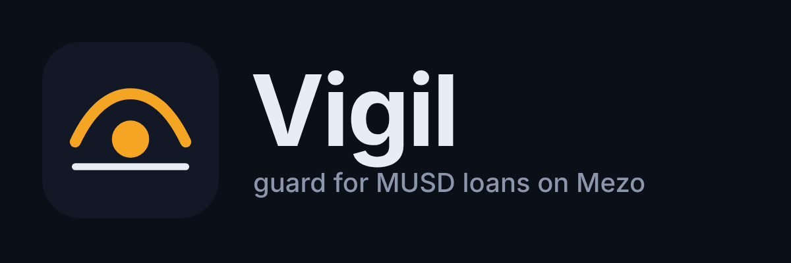

<p align="center"></p>

# Vigil

**A guardian for MUSD loans on Mezo.** Vigil watches your trove, warns you in Telegram before you get liquidated *or redeemed against*, and can submit a rescue you signed in advance, from a MUSD reserve only you control.

- Demo video (1:40): https://youtu.be/0sAUZjEPfE4
- App: https://vigil-mezo.up.railway.app
- Telegram: [@VigilMezoBot](https://t.me/VigilMezoBot)
- Contract (Mezo testnet, verified): [`VigilReserve` 0x9829…cf3E](https://explorer.test.mezo.org/address/0x9829963c86bf6A8AC47b0996eAD58cf3e630cf3E)
- Evidence (transactions, tests, read-backs): [`docs/evidence.md`](docs/evidence.md)

## The problem

Borrowing MUSD against BTC on Mezo has two ways to lose collateral, and most borrowers only watch one:

1. **Liquidation** below 110% collateral ratio.
2. **Redemption.** Anyone can redeem MUSD for BTC at par, and Mezo takes that BTC from the *lowest-ratio loans above 110% first*. A loan at 130% can be partly redeemed on a quiet day if it sits at the front of the queue.

Price alerts don't cover the second risk. Most of the time the fix is a small repay, and the borrower has to be awake to make it.

## What Vigil does

| | |
|---|---|
| **Liquidation price** | The BTC price where your ratio hits 110%, and how far away it is. |
| **Redemption queue** | Your place in Mezo's redemption order (`SortedTroves`, ascending nominal ICR, skipping loans under 110%) and how much MUSD gets redeemed before yours. |
| **Interest drift** | Days until simple interest alone takes you to 110% at a flat price. |
| **Stale price** | Mezo's `PriceFeed` reverts when its oracle is over 60 s old. Vigil reports "paused" and never acts on a guessed price. |
| **Pre-signed rescue** | You keep a MUSD reserve in `VigilReserve` and sign Mezo's own `RepayMUSD` message once. If your ratio falls below the trigger you set, the keeper submits exactly that repay. |

## Why the rescue is safe

The rescue goes through Mezo's `BorrowerOperationsSignatures.repayMUSDWithSignature`. Mezo checks the borrower's EIP-712 signature over `(amount, borrower, nonce, deadline)` and burns the MUSD from the caller, which is the Vigil reserve contract. So:

- **Mezo, not Vigil, enforces** the amount, the loan and the deadline. A changed amount fails with `Invalid signature`.
- `VigilReserve` adds two checks: the ratio at a **fresh oracle price** must be under **your** trigger, and only **your** reserve can pay.
- Each signature works once (Mezo's nonce). Signing any other Mezo action voids it.
- `VigilReserve` has no owner, no admin and no keeper allow-list. Anyone may submit a rescue, because a rescue can only spend your reserve on your debt, below your trigger. You can withdraw the reserve at any time.

## Proof

All on Mezo testnet (chain 31611). Details and links are in [`docs/evidence.md`](docs/evidence.md).

- **12/12 fork tests** against the real MUSD contracts: one allowed rescue, plus rejections for a stale oracle, a tampered amount, an expired signature, a moved nonce, a replay, a short reserve, rescue switched off, and someone else withdrawing your reserve.
- **Live rescue (2026-10-16):** the Railway keeper repaid 300 MUSD from the reserve. Ratio went from 130.94% to 148.77% ([tx](https://explorer.test.mezo.org/tx/0x36505f769fecbff092c85736a9f09e1c9fc006bf4454d387effe70a8ad5e8347)).
- **Live rejections:** `AboveTrigger` ([tx](https://explorer.test.mezo.org/tx/0x94b9e31e8c385f7459ec69c265a7c78dc924e0f5f60704fb8a79135f9a7417da)) and Mezo's `Invalid signature` for a tampered amount ([tx](https://explorer.test.mezo.org/tx/0x5400e79bbcf8e84252b8d37afbd2d6bd24c4c60f336ba638ccf4ac5366a77168)).

The test borrower's setup transactions were scripted (`scripts/live-demo.sh`); the rescue transaction itself came from the live keeper.

## Which address?

Watch the **0x Mezo address that owns the loan** (the trove owner). If you sign in to Mezo with a Bitcoin wallet through Mezo Passport, that is the 0x smart account the Mezo app shows, not your `bc1…` address.

Alerts work for any owner. The pre-signed rescue needs an EVM wallet (MetaMask, Rabby): Mezo checks rescue signatures with `ECDSA.recover(...) == borrower`, which a Passport smart account cannot satisfy.

## Architecture

```
Telegram ──► bot (grammy) ─┐
Web page ──► API (hono) ───┤ one Node service on Railway
                           ├─ monitor: every 60 s, reads all troves via Multicall3,
                           │           PriceFeed.fetchPrice, computes risk, sends alerts
                           └─ keeper:  for armed signatures, canRescue → simulate → rescue()
                                       │
Mezo testnet ◄─────────────────────────┘
  VigilReserve ──► BorrowerOperationsSignatures.repayMUSDWithSignature ──► MUSD burn
               └─► PriceFeed.fetchPrice, TroveManager.getCurrentICR
```

| Path | What |
|---|---|
| `contracts/` | Foundry project: `VigilReserve.sol`, fork tests, deploy script |
| `bot/src/risk.ts` | Pure risk maths (bigint, 1e18) with unit tests |
| `bot/src/snapshot.ts` | Trove and price reads |
| `bot/src/telegram.ts` | Commands and alerts |
| `bot/src/keeper.ts` | Rescue submission |
| `bot/src/web.ts`, `bot/src/web/app.html` | Health, API and the wallet page (no JS libraries, plain EIP-1193) |

## Run it

```bash
# contracts (fork tests hit https://rpc.test.mezo.org)
cd contracts && forge test

# service
cd bot && npm install && cp .env.example .env   # set TELEGRAM_BOT_TOKEN
npm test && npm start                            # http://localhost:3000
npm run inspect -- 0xBorrower                    # one-off position read
```

Mezo contracts used (testnet): MUSD `0x1189…c503`, TroveManager `0xE47c…6bb0`, BorrowerOperationsSignatures `0xD757…639e`, PriceFeed `0x86bC…9366`, from [mezo-org/musd](https://github.com/mezo-org/musd) deployments, read back on-chain.

## Status

Mezo testnet only. Built for the Mezo Buildathon (Wave 1, Track 2: Access & Distribution). Not audited.
